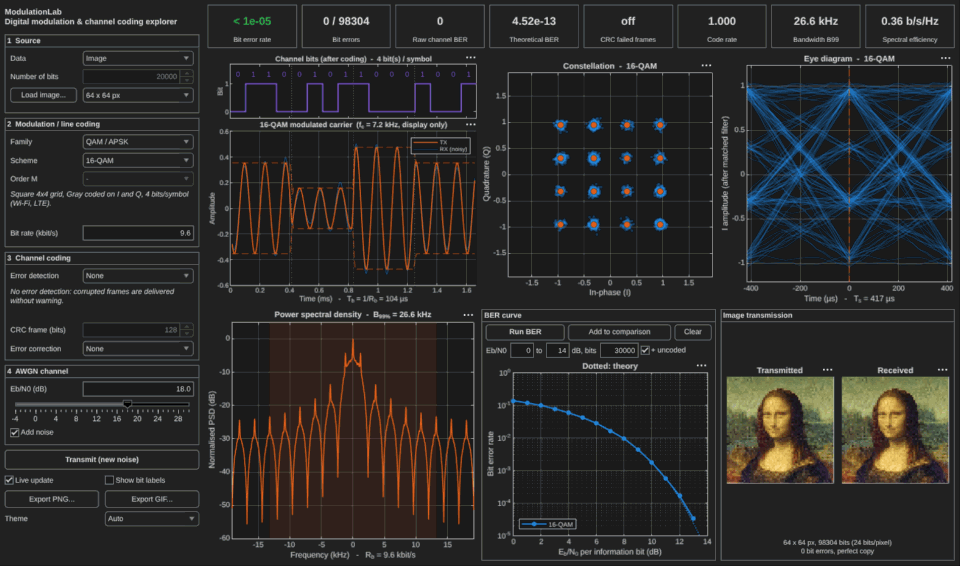
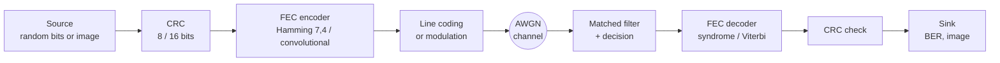
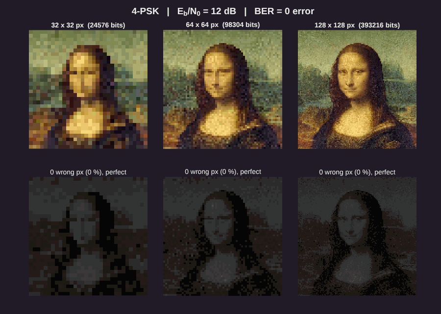
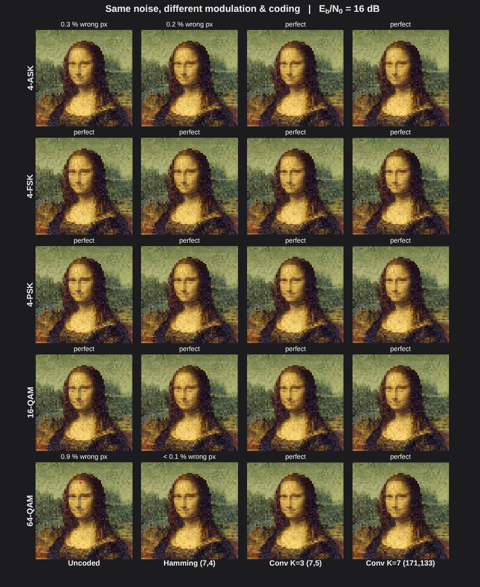
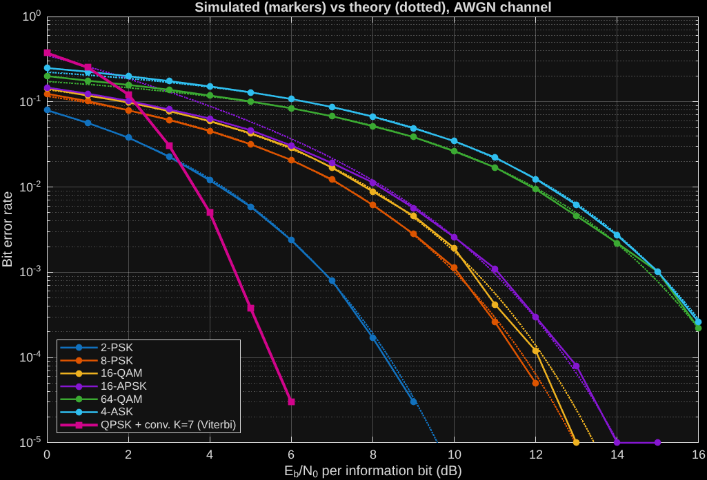
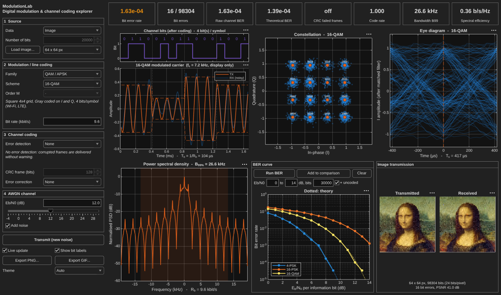

<div align="center">

# 📡 ModulationLab

**Interactive digital communications lab in MATLAB: line coding, modulation, channel coding and AWGN, all written from scratch.**

[](https://github.com/ant-one-dev/ModulationLab/actions/workflows/tests.yml)




*Lower the Eb/N0 slider: the constellation spreads, the eye closes and the Mona Lisa fills with wrong pixels.*

</div>

---

## Contents

- [Highlights](#highlights)
- [The transmission chain](#the-transmission-chain)
- [Features](#features)
- [Gallery](#gallery)
- [Getting started](#getting-started)
- [How it works](#how-it-works)
- [CRC-8 vs CRC-16](#crc-8-vs-crc-16)
- [Things worth trying](#things-worth-trying)
- [Project structure](#project-structure)
- [Credits and license](#credits-and-license)

## Highlights

- 🧮 **Built from scratch**: no Communications, Signal Processing or Image Processing Toolbox. Every modulator, demodulator, CRC, Hamming code and Viterbi decoder is plain MATLAB.
- 🖥️ **One screen, live**: time signal, constellation, eye diagram, spectrum, BER curve and a transmitted image update as you move the Eb/N0 slider.
- 🎯 **Checked against theory**: the simulated BER of every scheme matches its closed-form expression (within 15 % at BER ≈ 10⁻², enforced by the test suite).
- 🖼️ **Image transmission**: send the *Mona Lisa* (or any picture) in colour, 24 bits per pixel, and see what bit errors really look like.
- 📈 **Comparison mode**: overlay the BER curves of several modulations and codes on the same plot.
- 🎞️ **Exports**: PNG of the window and animated GIFs, ready to share.

## The transmission chain



## Features

| Block | What is implemented |
|---|---|
| **Source** | Random bits, or a colour image (24 bits/pixel) rebuilt at the receiver. Default image: the *Mona Lisa* |
| **Error detection** | CRC-8 (`x⁸+x²+x+1`) and CRC-16-CCITT (`x¹⁶+x¹²+x⁵+1`), configurable frame size, count of corrupted frames the CRC missed |
| **Error correction** | Hamming (7,4) with syndrome decoding; rate-½ convolutional codes K=3 (7,5) and K=7 (171,133) with a hard-decision **Viterbi** decoder |
| **Line coding** | Unipolar NRZ, Polar NRZ (antipodal), Unipolar RZ, Polar RZ, Manchester (IEEE 802.3), AMI (bipolar), 2B1Q |
| **Amplitude** | OOK, BASK, M-ASK with **M = 4, 8, 16** (Gray coded) |
| **Phase** | M-PSK with **M = 2, 4, 8, 16, 32** (Gray coded) |
| **Frequency** | BFSK and 4-FSK: orthogonal tones, continuous phase, non-coherent detection |
| **QAM / APSK** | 16-QAM, 64-QAM, 16-APSK and 32-APSK (DVB-S2 ring ratios) |
| **Pulse shape** | Rectangular: one constant symbol per period, so every phase or amplitude jump is visible |
| **Bit rate** | Adjustable R_b: time axes in seconds, spectrum and occupied bandwidth in Hz |
| **Channel** | AWGN, with Eb/N0 defined **per information bit** so that coding gains are fair |

**Visualisations**: channel bits aligned with the modulated carrier · constellation with optional bit labels (decision histogram for line codes, I/Q trajectory for FSK) · eye diagram · power spectral density with 99 % bandwidth · BER curves, simulated vs theoretical, coded vs uncoded · image sent vs received, with PSNR · key figures (BER, raw channel BER, CRC failures, code rate, bandwidth, spectral efficiency).

## Gallery

<table>
<tr>
<td width="50%" align="center">

<br><b>Same noise, three resolutions.</b> Wrong pixels are highlighted below each image. The fraction of wrong pixels only depends on the BER, but the eye forgives them far more at 128 px.
</td>
<td width="50%" align="center">

<br><b>5 modulations × 4 codes, same Eb/N0.</b> QPSK is the most robust; the K=7 Viterbi decoder cleans 64-QAM almost entirely above 12 dB.
</td>
</tr>
<tr>
<td width="50%" align="center">

<br><b>Simulation matches theory.</b> Markers are simulated, dotted lines are the closed-form BER. The K=7 code buys about 3 dB on QPSK at 10⁻⁴.
</td>
<td width="50%" align="center">

<br><b>The main window.</b> Settings on the left, key figures on top, six live views and a BER comparison.
</td>
</tr>
</table>

## Getting started

**Requirements**: MATLAB R2021a or newer, no toolbox. Developed and tested on R2026b; the theme selector needs R2025a.

```matlab
>> cd ModulationLab
>> ModulationLab
```

**Run the tests**

```matlab
>> cd tests
>> runTests
```

They check the CRC values against the standard `"123456789"` check vectors (`0xF4`, `0x31C3`), the Hamming and Viterbi decoders, the Gray mapping of every constellation, the error-free chain for every scheme and code, and the simulated BER against theory. The same tests run on GitHub Actions at every push.

**Use the engine without the GUI**

```matlab
addpath(genpath('src'));
cfg = defaultConfig(struct('scheme', '16-QAM', 'EbN0dB', 10, 'fec', 'Hamming (7,4)'));
res = runChain(cfg, randi([0 1], 1e5, 1));
fprintf('BER = %.2e (raw channel BER %.2e)\n', res.ber, res.rawBER);
```

**Regenerate the figures**

| Script | Output |
|---|---|
| `demo_ber_comparison('docs/ber_curves.png')` | BER curves, simulated vs theory |
| `record_app_gif` | `docs/app_demo.gif`: the whole window while Eb/N0 decreases |
| `record_image_gif` | `docs/image_demo.gif`: received image at three resolutions |
| `T = record_compare_gif` | `docs/compare_demo.gif` and a table of wrong pixels per modulation and code |

Run them after `addpath examples`. Each one takes optional arguments (scheme, Eb/N0 range, sizes...); see the help at the top of each file.

## How it works

- **Complex baseband.** Passband schemes are simulated through their complex envelope at 16 samples per symbol. The carrier is added only for display.
- **Rectangular pulses and matched filters.** Each symbol holds its value for one period. The receiver integrates over the symbol (the matched filter of a rectangular pulse) and samples at the end, which is optimal on the AWGN channel.
- **Decisions.** Linear modulations use a minimum-distance decision on the constellation. Line codes use integrate-and-dump over the useful part of the bit. M-FSK uses non-coherent energy detection on each tone.
- **Energy accounting.** Eb/N0 is defined per *information* bit: the energy spent on CRC, parity and tail bits is counted, so a code only shows a gain if it really earns it.
- **Theory.** Closed-form BERs (Q-function expressions for OOK, ASK, PSK, QAM, line codes, non-coherent M-FSK) are drawn next to the simulation. APSK has no closed form, so its union bound is computed from the actual constellation and bit labelling.

## CRC-8 vs CRC-16

Both divide each frame by a generator polynomial and append the remainder; the receiver recomputes it and flags the frame if it differs.

| | CRC-8 | CRC-16-CCITT |
|---|---|---|
| Check bits per frame | 8 | 16 |
| Overhead on a 128-bit frame | 6 % | 11 % |
| Error bursts always detected | up to 8 bits | up to 16 bits |
| Odd number of bit errors | always detected | always detected |
| Badly corrupted frames that slip through | about 1 in 256 | about 1 in 65,536 |

Measured with ModulationLab (QPSK at Eb/N0 = −2 dB, 46,875 frames of 64 bits): **CRC-8 missed 197 corrupted frames** (about 1 in 240), **CRC-16 missed none**.

## Things worth trying

- **Same bit rate, different bandwidth**: switch from 2-PSK to 32-PSK or 64-QAM and watch the spectrum shrink while the BER curve moves right.
- **Coding below threshold**: with 4-ASK at 8 dB, the K=7 code makes the image *worse* than no code at all (91 % wrong pixels vs 78 %). From 14 dB on, it makes it perfect.
- **Correlated errors**: with 4-FSK, Hamming (7,4) degrades the image. One wrong FSK symbol often flips both of its bits, which then fall in the same 7-bit codeword, and Hamming only corrects one error per word. Real systems interleave the bits to spread such errors.
- **Line code spectra**: Manchester has no DC component and nulls at 2 R_b; unipolar NRZ has a strong DC line.
- **CRC misses**: choose CRC-8 and go below 0 dB; the "missed" counter appears. With CRC-16 it stays at zero.

## Project structure

```
ModulationLab.m          main window (programmatic uifigure, single screen)
src/
  core/                  runChain (whole TX -> channel -> RX chain), simulateBER, scheme catalog
  coding/                CRC, Hamming (7,4), convolutional encoder, Viterbi decoder
  linecode/              line code encoder and integrate-and-dump decoder
  modulation/            constellations, modulator, demodulators, receive filter
  analysis/              theoretical BER, union bound, Welch PSD, occupied bandwidth
  source/                image <-> bits, default image
  plots/                 time, constellation, spectrum and eye plots (work on any axes)
  export/                GIF writer
  utils/                 bit/integer conversions, Gray code, Q function, unit prefixes
tests/runTests.m         self-checks
examples/                scripts that use the engine without the GUI and build the figures above
assets/mona_lisa.png     default image
docs/                    README illustrations
```

## Credits and license

Default image: *Mona Lisa*, Leonardo da Vinci, public domain, from [Wikimedia Commons](https://commons.wikimedia.org/wiki/File:Mona_Lisa,_by_Leonardo_da_Vinci,_from_C2RMF_retouched.jpg) (cropped and resized).

Code released under the [MIT license](LICENSE).
